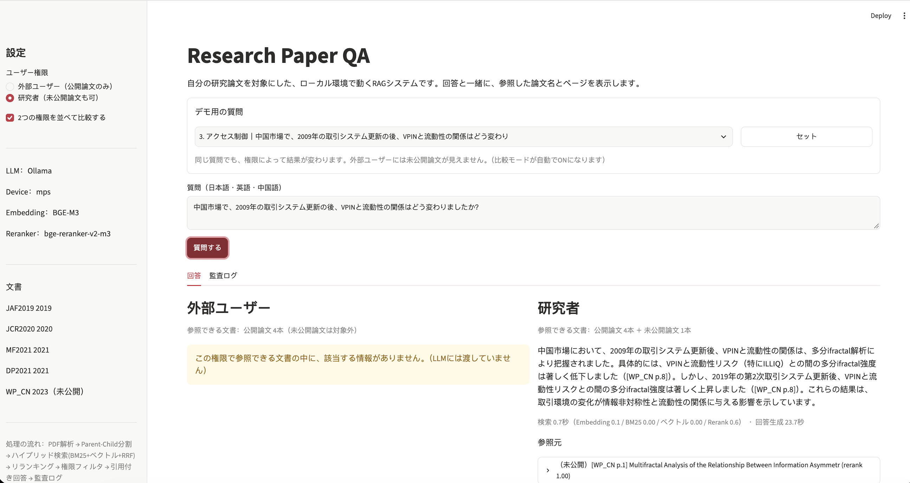

# Research Paper QA (RAG)

A **fully local RAG (Retrieval-Augmented Generation) system** built over five of my own research papers.
It answers questions **with citations to the paper and page number** it used.
No data is sent to external AI services, so the design fits organizations that handle confidential documents.



## Features

- **Hybrid search**: keyword search (BM25) and vector search (BGE-M3 + Qdrant), merged with Reciprocal Rank Fusion (RRF)
- **Reranking**: a cross-encoder (bge-reranker-v2-m3) reorders the top 10 candidates and passes the top 4 to the LLM
- **Cited answers**: every claim carries a source label such as `[MF2021 p.7]`, and the original passages can be opened in the UI
- **Refuses out-of-scope questions**: if no relevant passage is found, the LLM is not called and the app says so (to prevent hallucination)
- **Access control**: each user role can only search the documents it is allowed to see (external users cannot access the unpublished paper). The filter is applied **before** retrieval
- **Role comparison mode**: runs the same question under two roles side by side to show the difference
- **Audit log**: records each question with its role, the sources used and the outcome
- **Multilingual**: the papers are in English, but questions can be asked in Japanese, English or Chinese

## Pipeline

```
PDF parsing (two-column aware, references and noise removed)
  → Parent-child chunking (small chunks for retrieval, larger surrounding chunks for the LLM)
  → Access filter
  → Hybrid search (BM25 + vector search → RRF)
  → Reranking (cross-encoder)
  → Cited answer (local LLM, streamed)
  → Audit log
```

## Tech stack

| Area | Technology |
|---|---|
| Language / UI | Python, Streamlit |
| PDF parsing | PyMuPDF |
| Embeddings | BAAI/bge-m3 (sentence-transformers) |
| Vector DB | Qdrant (in-memory) |
| Keyword search | rank-bm25 |
| Reranker | BAAI/bge-reranker-v2-m3 |
| LLM | Ollama + Qwen2.5 7B (falls back to Llama 3.2 3B) |
| Hardware | Apple Silicon (MPS) / CUDA / CPU, selected automatically |

## Files

```
├── app.py               # Streamlit demo UI
├── rag_core.py          # Core RAG logic (parsing, chunking, retrieval, reranking, generation)
├── build_index.py       # Builds the index (run once before the demo)
├── demo_questions.json  # Demo questions
└── requirements.txt
```

## Getting started

> **Note:** The paper PDFs and the index built from them (`index/`) are not included in this repository, for copyright reasons and because one paper is unpublished.
> To run the app, provide PDFs with the file names listed in `PAPERS` in `rag_core.py`.

### 1. Install dependencies

```bash
pip install -r requirements.txt
```

### 2. Set up Ollama and the LLM

Install [Ollama](https://ollama.com/), then pull the LLM model


### 3. Build the index (first time only)

Point to the folder containing the PDFs.
On the first run, set `PAPER_RAG_ONLINE=1` so the embedding model can be downloaded.

```bash
export PAPER_RAG_DATA=/path/to/pdf_folder
PAPER_RAG_ONLINE=1 python build_index.py
```

### 4. Launch the app

The first launch also downloads the reranker, so set `PAPER_RAG_ONLINE=1`. After that, the app runs offline.

```bash
PAPER_RAG_ONLINE=1 streamlit run app.py
```

### Environment variables

| Variable | Purpose | Default |
|---|---|---|
| `PAPER_RAG_DATA` | Folder containing the PDFs | Author's local path (set this yourself) |
| `PAPER_RAG_INDEX` | Where the index is saved | `./index` |
| `PAPER_RAG_ONLINE` | Set to `1` to allow model downloads | Offline |
| `PAPER_RAG_DEVICE` | Force `cpu` / `mps` / `cuda` | Auto |

## Demo questions (examples)

| # | What it shows | Question |
|---|---|---|
| 1 | Asking in Japanese | 日本市場で、流動性ファクターが有効なのはどんな相場ですか？ |
| 2 | Numerical accuracy | 主成分分析で、上位2つの主成分は流動性指標の変動の何%を説明しましたか？ |
| 3 | Access control | 中国市場で、2009年の取引システム更新の後、VPINと流動性の関係はどう変わりましたか？ |
| 4 | Out-of-scope question | 日本銀行の現在の政策金利は何ですか？ |
| 5 | Asking in English | Which algorithm was used to define bull and bear markets in Japan? |

## Author

ZHONG
